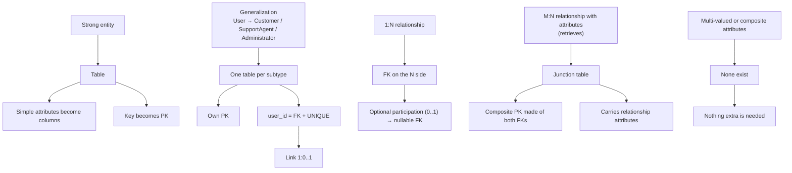
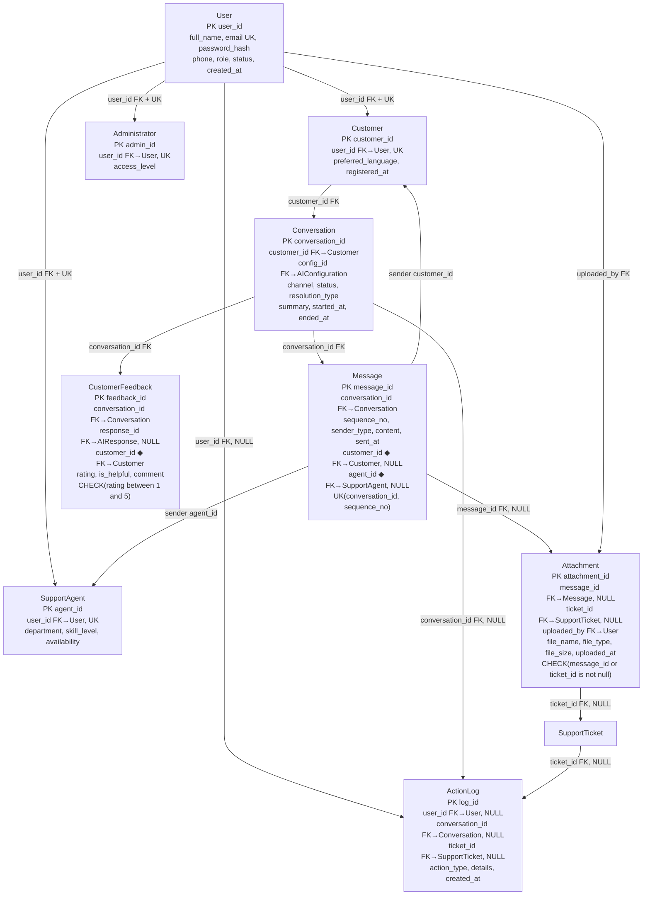
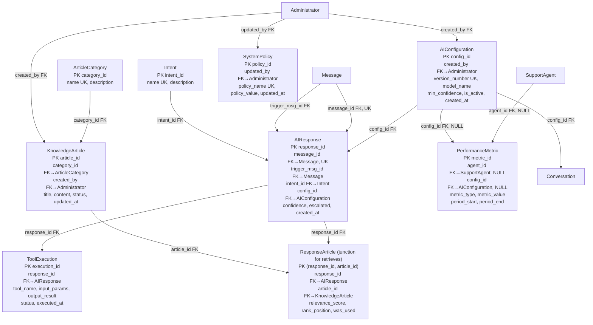
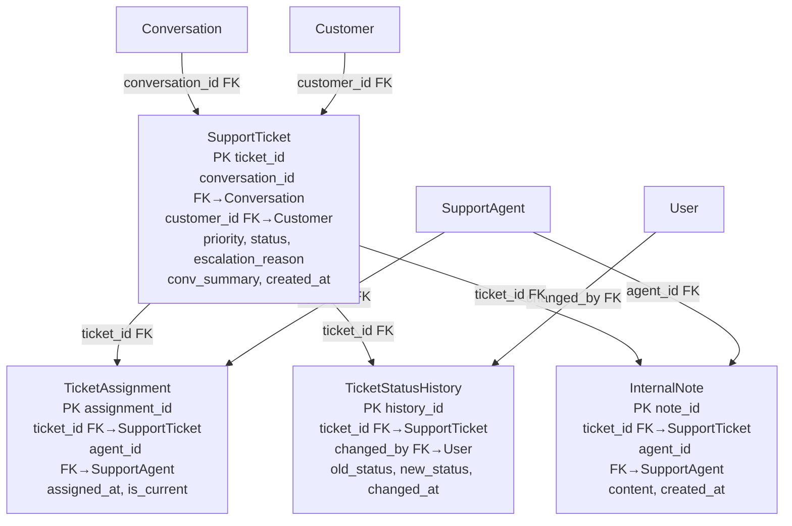
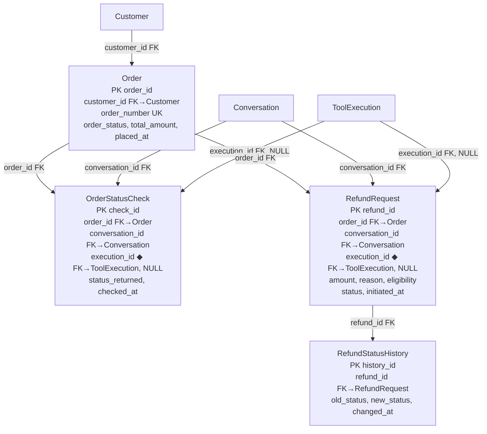

# Mapping

## Mapping rules applied

## Relational schema

**PK** is the primary key, **FK** is a foreign key, **UK** is a unique key, and ◆ marks FKs that the diagrams don’t draw as ovals.

### Users and conversations

### AI, knowledge base and configuration

### Tickets

### Orders and refunds

## Relationship-to-FK mapping

```mermaid
flowchart TD
    R1["is a (1)"] --> M1["user_id UNIQUE FK in each of the 3 subtype tables"]
    R2["starts, governs, contains (2–4)"] --> M2["Conversation.customer_id<br/>Conversation.config_id<br/>Message.conversation_id"]
    R3["sends (5, 6)"] --> M3["Message.customer_id and Message.agent_id, both nullable;<br/>if both are NULL the AI sent it"]
    R4["recorded as (7)"] --> M4["AIResponse.message_id, UNIQUE (1:0..1)"]
    R5["triggers, classifies, produces (8–10)"] --> M5["AIResponse.trigger_msg_id, intent_id, config_id"]
    R6["retrieves (11), M:N"] --> M6["junction table ResponseArticle"]
    R7["groups, manages, invokes (12–14)"] --> M7["category_id, created_by, ToolExecution.response_id"]
    R8["carries, includes, uploads (15–17)"] --> M8["Attachment.message_id, ticket_id, uploaded_by"]
    R9["rated in, gives, evaluated by (18–20)"] --> M9["CustomerFeedback.conversation_id, customer_id, response_id"]
    R10["escalates to, raises (21, 22)"] --> M10["SupportTicket.conversation_id, customer_id"]
    R11["assigned via, handles (23, 24)"] --> M11["TicketAssignment.ticket_id, agent_id"]
    R12["tracked in, changes, has, writes (25–28)"] --> M12["FKs on TicketStatusHistory and InternalNote"]
    R13["places, checked via, involves, performed by (29–32)"] --> M13["FKs on Order and OrderStatusCheck"]
    R14["refunded by, initiates, executed by, tracked in (33–36)"] --> M14["FKs on RefundRequest and RefundStatusHistory"]
    R15["creates, maintains (37, 38)"] --> M15["AIConfiguration.created_by, SystemPolicy.updated_by"]
    R16["measured by (39, 40)"] --> M16["PerformanceMetric.agent_id, config_id, both nullable"]
    R17["performs, logged in (41–43)"] --> M17["ActionLog.user_id, conversation_id, ticket_id, all nullable"]
```

## Points to watch in the source document

- **Counts don’t match.** The overview says 25 entities and 42 relationships, but the dictionary has 26 tables (25 entities plus the `retrieves` junction) and section 6 lists 43 relationships.
- **Reserved words.** `User` and `Order` are reserved words in SQL Server, so write them as `[User]` and `[Order]`, or name them `Users` and `Orders`.
- **Circular FK path.** `Conversation` and `SupportTicket` reference each other only indirectly, but `Attachment` points to both `Message` and `SupportTicket`. Create tables in this order: User → subtypes → AIConfiguration → Conversation → Message → AIResponse → SupportTicket → Attachment.
- **Cascade conflicts.** `AIResponse` has two FKs to `Message`. SQL Server rejects multiple cascade paths, so use `ON DELETE NO ACTION` on `trigger_msg_id`.
